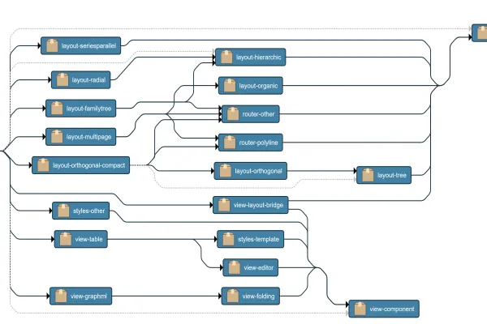

<!--
 //////////////////////////////////////////////////////////////////////////////
 // @license
 // This file is part of yFiles for HTML.
 // Use is subject to license terms.
 //
 // Copyright (c) 2026 by yWorks GmbH, Vor dem Kreuzberg 28,
 // 72070 Tuebingen, Germany. All rights reserved.
 //
 //////////////////////////////////////////////////////////////////////////////
-->
# Transitivity Demo – yFiles for HTML

[You can also run this demo online](https://www.yfiles.com/demos/analysis/transitivity/).

Transitivity algorithms are heavily applied to graphs in order to answer reachability questions such as _"Is it possible to reach node x from y?"_. Common application fields are social networks, dependency graphs, bioinformatics, citation graphs or criminal networks in which possible relations between two entities have to be quickly identified and investigated.

The sample graph shows a fictional yfiles for HTML modules dependencies graph. The user can select a node and investigate its dependents and dependencies.

## Algorithms

The user can select one of the available algorithms from the algorithms' combo box. Selecting the _Original Graph_ will bring the graph to its original state without the transitive edges.

### Transitive Closure

Transitive Closure is applied in order to answer the question whether there exists a directed path between two nodes. The algorithm adds an edge to the graph for each pair of nodes that are not direct neighbors but connected by a path in the graph. The transitive edges are visualized in red color.

### Transitive Reduction

Transitive Reduction is the reverse operation to transitive closure which removes edges between any two nodes if there exists another path that connects them. This means that in the end, the graph remains with as few edges as possible but has the same reachability relation as before. The user can choose to show or hide transitive edges by using the asterisk\-Button of the toolbar.

## Graph Information

Package Name

Dependents

Dependencies

Node Count

Edge Count
