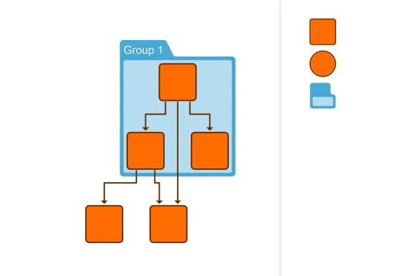

<!--
 //////////////////////////////////////////////////////////////////////////////
 // @license
 // This file is part of yFiles for HTML.
 // Use is subject to license terms.
 //
 // Copyright (c) 2026 by yWorks GmbH, Vor dem Kreuzberg 28,
 // 72070 Tuebingen, Germany. All rights reserved.
 //
 //////////////////////////////////////////////////////////////////////////////
-->
# HTML Drag And Drop Demo – yFiles for HTML

[You can also run this demo online](https://www.yfiles.com/demos/application-features/drag-and-drop-html/).

This demo shows how to use [NodeDropInputMode](https://docs.yworks.com/yfileshtml/api/NodeDropInputMode) in combination with native HTML `draggable` elements that can be dragged and dropped into the graph.

- Drag nodes and group nodes into the graph.
- Drop nodes and group nodes on other group nodes to add them as their children.

See the sources for details.

Note that the HTML native drag and drop API does not work with most touch devices. For a drag and drop experience that works for touch devices and other pointer devices, consider using the yFiles drag and drop mechanism outlined in the [Drag and Drop Demo](../../input/draganddrop/).
